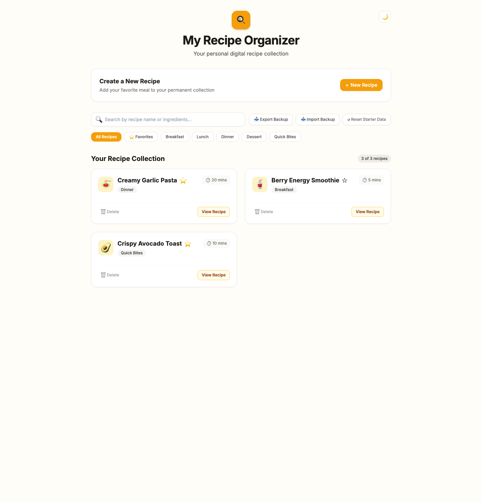
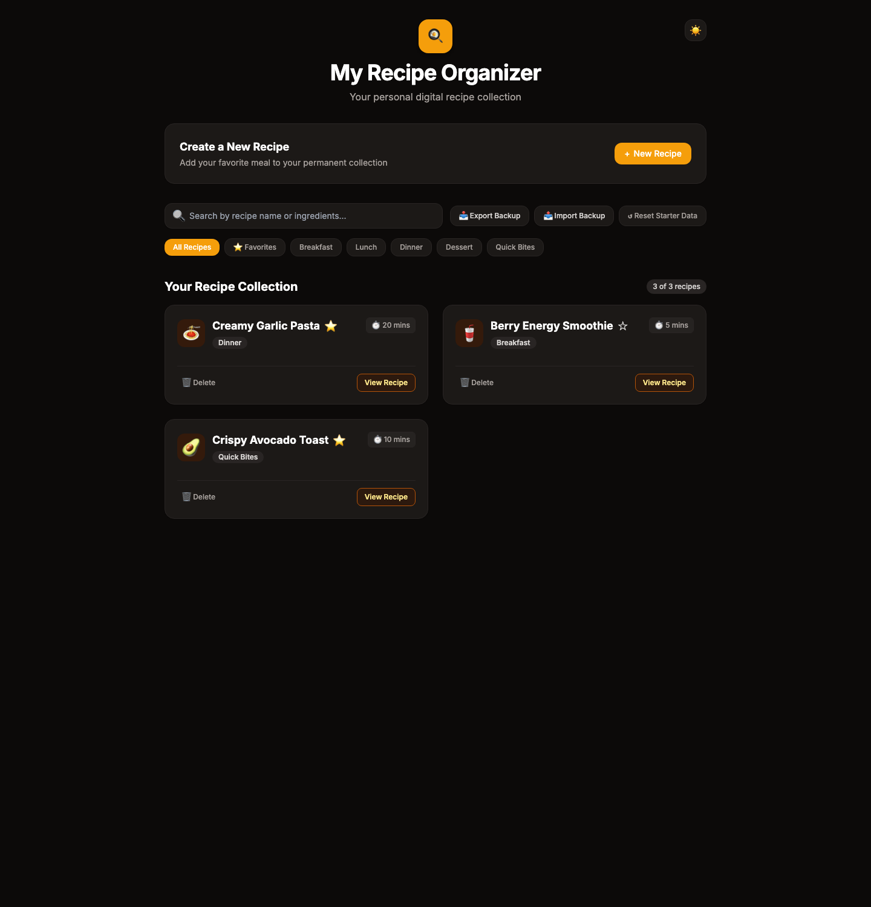
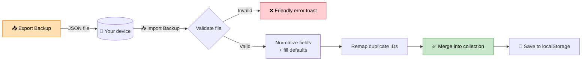

<a id="top"></a>

<div align="center">

# 🍳 My Recipe Organizer

**Your personal digital recipe box — create, scale, time, search, and back up every meal.**

A modern, responsive, zero-dependency web app built with vanilla JavaScript, HTML5, and Tailwind CSS.

[](https://dhanush-blr.github.io/my-recipes/)
[](https://github.com/dhanush-blr/my-recipes/stargazers)
[](https://github.com/dhanush-blr/my-recipes/commits/main)
[](https://github.com/dhanush-blr/my-recipes)
[](#tech-stack)

[🚀 **Launch App**](https://dhanush-blr.github.io/my-recipes/) &nbsp;·&nbsp; [✨ **Features**](#features) &nbsp;·&nbsp; [🔄 **Backup & Restore**](#backup-restore) &nbsp;·&nbsp; [❓ **FAQ**](#faq) &nbsp;·&nbsp; [🐛 **Report a Bug**](https://github.com/dhanush-blr/my-recipes/issues/new)

</div>

> [!TIP]
> **Try it in 10 seconds:** open the [live app](https://dhanush-blr.github.io/my-recipes/), hit **+ New Recipe**, and save your first dish. No signup, install, or account required.

> [!NOTE]
> **New in this release:** 📤 **Import Backup** — restore your recipe library from a JSON file without losing what's already there. [See how it works ↴](#backup-restore)

---

<a id="contents"></a>

## 🧭 Table of Contents

| 🍽️ Cook | 🧑‍💻 Build | 🔍 Explore |
| :--- | :--- | :--- |
| [Live Demo](#live-demo)<br>[Screenshots](#screenshots)<br>[Feature Tour](#features) | [Run Locally](#run-locally)<br>[Tech Stack](#tech-stack)<br>[Project Structure](#project-structure) | [Backup & Restore](#backup-restore)<br>[FAQ](#faq)<br>[Hosting](#hosting) |

---

<a id="live-demo"></a>

## 🚀 Live Demo

<div align="center">

### [👉 dhanush-blr.github.io/my-recipes](https://dhanush-blr.github.io/my-recipes/)

Hosted on GitHub Pages · No build step · Works in any modern browser

</div>

> [!IMPORTANT]
> All data stays **in your browser**. Recipes are saved to `localStorage` — nothing is uploaded to a server.

---

<a id="screenshots"></a>

## 📸 Screenshots

*Click a screenshot to open the live app.*

| <a href="https://dhanush-blr.github.io/my-recipes/"></a> | <a href="https://dhanush-blr.github.io/my-recipes/"></a> |
| :---: | :---: |
| ☀️ **Light Mode** | 🌙 **Dark Mode** |

---

<a id="features"></a>

## ✨ Feature Tour

| | Feature | What it does |
| :---: | :--- | :--- |
| 📱 | **Fully Responsive** | Fluid, mobile-first layout that adapts to phones, tablets, and wide monitors. |
| ⚖️ | **Dynamic Servings Scaler** | Interactive `[ − \| 1 \| + ]` stepper that recalculates ingredient quantities with regex-powered scaling. |
| ⏳ | **Kitchen Countdown Timer** | Per-recipe start/pause/reset timer with visual alerts and a synthesized Web Audio chime. |
| 🔍 | **Instant Search & Filter** | Live filtering by recipe name, individual ingredients, and category pills. |
| ⭐ | **Favorites & Bookmarks** | Star go-to meals and filter your collection down to favorites in one click. |
| 💾 | **Offline Persistence** | Recipes and preferences stored locally in your browser via `localStorage`. |
| 🖨️ | **Kitchen-Ready Print Styles** | `@media print` rules strip web chrome and format recipe cards for the counter. |
| 📥 | **Backup & Export** | Download your complete recipe library as a portable JSON file. |
| 📤 | **Import & Restore** | Merge recipes from a JSON backup with validation, defaults, and duplicate-ID protection. |
| 🌙 | **Glare-Free Dark Mode** | One-click theme toggle with saved preference for dim evening kitchens. |

<details>
<summary><b>⚖️ How does the servings scaler work?</b> &nbsp;<i>(click to expand)</i></summary>

<br>

Every ingredient string is scaled with a regular expression that finds leading quantities, including fractions and decimals, then multiplies them by the new serving ratio. The original `baseServings` is preserved so scaling always starts from the true recipe amount — no rounding drift from repeated scaling.

```js
// Simplified idea
ingredient.replace(/^(\d+(?:\.\d+)?|\d+\/\d+)/, (qty) =>
  format(qty * (currentServings / baseServings))
);
```

</details>

<details>
<summary><b>⏳ How does the timer notify me?</b> &nbsp;<i>(click to expand)</i></summary>

<br>

The timer is driven by `setInterval` with pause/resume support. When it reaches zero, the card updates visually and a short chime is synthesized with the **Web Audio API** — no audio files to download. The timer is per-recipe, so multiple dishes can run at once.

</details>

<details>
<summary><b>🖨️ What do printed recipes look like?</b> &nbsp;<i>(click to expand)</i></summary>

<br>

Print mode hides the header, search bar, category pills, buttons, and modals. Recipe cards become clean bordered blocks with page-break protection (`break-inside: avoid`), so ingredients and steps never split awkwardly across pages.

</details>

---

<a id="backup-restore"></a>

## 🔄 Backup & Restore

Your recipes live in `localStorage`, which is great for privacy but easy to lose with a browser reset. The export/import pair gives you a portable, human-readable backup.



<details>
<summary><b>📥 Export: creating a backup</b> &nbsp;<i>(click to expand)</i></summary>

<br>

1. Click **📥 Export Backup** in the toolbar.
2. Your browser downloads a JSON file named with the export date, e.g. `my_recipes_backup_2026-11-10.json`.
3. Store it anywhere — cloud drive, email to yourself, or a USB stick.

The export contains every recipe plus favorites, servings, ingredients, and steps.

</details>

<details>
<summary><b>📤 Import: restoring a backup</b> &nbsp;<i>(click to expand)</i></summary>

<br>

Click **📤 Import Backup** and select a JSON file exported from this app. The importer is deliberately **additive and non-destructive**:

- ✅ **Validates first** — invalid JSON or non-recipe files are rejected before anything changes.
- 🧩 **Normalizes recipes** — missing category, time, icon, servings, or favorite fields get safe defaults.
- 🛡️ **Preserves existing data** — nothing is overwritten or deleted.
- 🔢 **Prevents ID collisions** — imported recipes that clash with existing IDs get fresh ones.
- 🎉 **Confirms with a toast** — you'll see exactly how many recipes were imported.

</details>

<details>
<summary><b>🧾 Backup JSON format</b> &nbsp;<i>(click to expand)</i></summary>

<br>

```json
[
  {
    "id": 1,
    "title": "Creamy Garlic Pasta",
    "category": "Dinner",
    "time": "20 mins",
    "icon": "🍝",
    "baseServings": 2,
    "currentServings": 2,
    "favorite": true,
    "ingredients": ["200g pasta", "3 cloves garlic", "1 cup cream"],
    "steps": ["Boil the pasta.", "Sauté the garlic.", "Combine and serve."]
  }
]
```

| Field | Type | Required | Default if missing |
| :--- | :--- | :---: | :--- |
| `title` | string | ✅ | — (recipe is skipped) |
| `category` | string | — | `Dinner` |
| `time` | string | — | `10 mins` |
| `icon` | string | — | `🍽️` |
| `baseServings` | number | — | `2` |
| `currentServings` | number | — | `baseServings` |
| `favorite` | boolean | — | `false` |
| `ingredients` | string[] | — | `[]` |
| `steps` | string[] | — | `[]` |
| `id` | number | — | Auto-generated |

</details>

---

<a id="getting-started"></a>

## 🏁 Getting Started

<a id="run-locally"></a>

### 💻 Run Locally

The app is a single `index.html` — no `npm`, Node.js, Python, or local server required.

```bash
# Clone the repository
git clone https://github.com/dhanush-blr/my-recipes.git

# Navigate into it
cd my-recipes

# Open the app (macOS)
open index.html

# Open the app (Windows)
start index.html
```

<details>
<summary><b>✅ First-run checklist</b> &nbsp;<i>(click to expand)</i></summary>

<br>

- [ ] Open the app and confirm the three starter recipes appear.
- [ ] Click **🌙** to switch to dark mode, then reload — the preference should persist.
- [ ] Create a recipe with **+ New Recipe**.
- [ ] Scale its servings and watch the ingredient quantities update.
- [ ] Start the kitchen timer.
- [ ] Click **📥 Export Backup**, then **📤 Import Backup** with that file.
- [ ] Print a recipe with `Cmd/Ctrl + P` to see the kitchen layout.

</details>

---

<a id="tech-stack"></a>

## 🛠️ Tech Stack

| Layer | Technology | Why |
| :--- | :--- | :--- |
| Markup | **HTML5** | Semantic, accessible structure |
| Styling | **Tailwind CSS** (CDN) | Responsive utilities + class-based dark mode |
| Logic | **Vanilla JavaScript** | Zero dependencies, zero build step |
| Audio | **Web Audio API** | Synthesized timer chime, no asset files |
| Storage | **localStorage** | Private, offline-first recipe persistence |
| Hosting | **GitHub Pages** | Free static deployment from `main` |

---

<a id="project-structure"></a>

## 📁 Project Structure

```text
my-recipes/
├── index.html          # Entire app: markup, styles, and logic
├── README.md           # You are here
└── screenshots/
    ├── app-light.png   # Light mode preview
    └── app-dark.png    # Dark mode preview
```

---

<a id="faq"></a>

## ❓ FAQ

<details>
<summary><b>Where are my recipes stored?</b></summary>

<br>

In your browser's `localStorage` under `recipe_organizer_user_data_v1`. They never leave your device. Clearing site data or using a different browser will show an empty collection — keep a JSON backup if that matters to you.

</details>

<details>
<summary><b>Does importing overwrite or delete my existing recipes?</b></summary>

<br>

No. Imports are merged into the front of your collection. Existing recipes stay untouched, and ID collisions are resolved automatically.

</details>

<details>
<summary><b>Can I use it offline?</b></summary>

<br>

Yes — your saved recipes live locally and the app logic is inline. The very first load still needs network access to fetch the Tailwind CDN and the font stylesheet; after that, your browser cache handles repeat visits.

</details>

<details>
<summary><b>How do I get back the sample recipes?</b></summary>

<br>

Click **↺ Reset Starter Data** in the toolbar. This restores the three built-in starter recipes.

</details>

<details>
<summary><b>Can I edit a recipe after creating it?</b></summary>

<br>

The current version supports creating, viewing, favoriting, deleting, scaling, and printing. Full inline editing is not implemented yet — delete and re-create, or edit the JSON backup and re-import it.

</details>

<details>
<summary><b>Can I host my own copy?</b></summary>

<br>

Absolutely. Fork the repo, then enable **Settings → Pages → Deploy from branch → `main` / root**. Your app will be live at `https://<your-username>.github.io/my-recipes/`.

</details>

<details>
<summary><b>Is there a backend or database?</b></summary>

<br>

No. The entire app is client-side and static. That keeps it free to host, instant to load, and private by default.

</details>

---

<a id="hosting"></a>

## 🌐 Hosting & Deployment

| | |
| :--- | :--- |
| **Live URL** | https://dhanush-blr.github.io/my-recipes/ |
| **Repository** | https://github.com/dhanush-blr/my-recipes |
| **Source branch** | `main` |
| **Deploy method** | GitHub Pages (static, root) |

Every push to `main` updates the live site automatically.

---

<a id="contributing"></a>

## 🤝 Contributing

Found a bug or have an idea? The whole app is one HTML file, so small contributions are easy:

- 🐛 [Open an issue](https://github.com/dhanush-blr/my-recipes/issues/new)
- ⭐ [Star the repo](https://github.com/dhanush-blr/my-recipes/stargazers) if it's useful
- 🍴 Fork, branch, and open a pull request

<details>
<summary><b>💡 Ideas that would fit nicely</b> &nbsp;<i>(click to expand)</i></summary>

<br>

- [ ] Inline recipe editing
- [ ] Drag-and-drop import with a preview diff
- [ ] Recipe sharing via URL-encoded data
- [ ] Shopping-list generation from selected recipes
- [ ] PWA manifest + service worker for true offline install
- [ ] Nutrition estimates per serving

</details>

---

<a id="license"></a>

## 📄 License

This project is open source and available for personal use.

---

<div align="center">

**[⬆ Back to top](#top)**

Made with 🍳, vanilla JS, and zero build steps.

</div>
